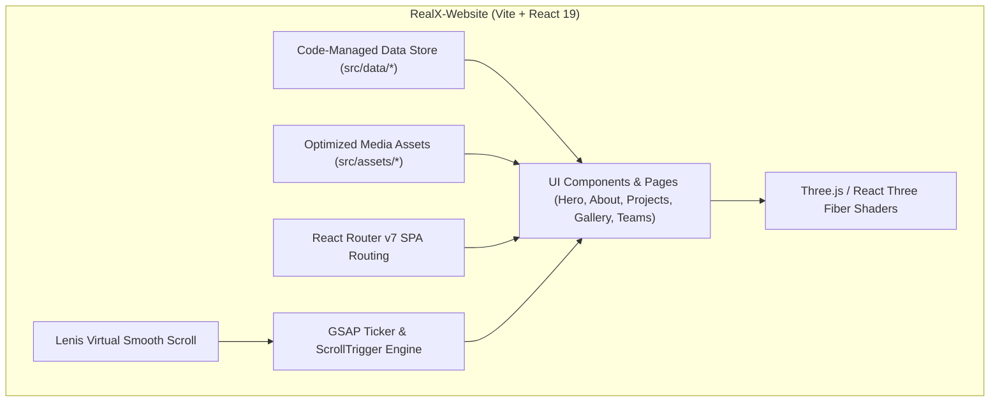

<div align="center">

# 🥽 REAL XR — SPATIAL COMPUTING LAB
### *We Don't Just Study the Future — We Build It.*

[](https://react.dev)
[](https://vitejs.dev)
[](https://threejs.org)
[](https://greensock.com)
[](https://tailwindcss.com)
[](https://lenis.darkroom.engineering)

**The official Awwwards-caliber portfolio and spatial showcase platform for RealXR — the premier AR/VR, Game Development, and Spatial Computing club of the Institute of Engineering and Science (IES IPS Academy, Indore · Est. 2022).**

[Explore Live Demo](#) · [Read Architecture](docs/ARCHITECTURE.md) · [Design System](docs/DESIGN.md) · [Maintenance Guide](docs/MAINTENANCE.md)

</div>

---

## 🌟 Overview & Key Highlights

**RealXR** is an experiential student laboratory pushing the boundaries of spatial computing. This web platform was engineered to serve as an **international award-caliber digital artifact**, combining real-time 3D graphics, custom GLSL shaders, frame-scrubbed video timelines, and editorial typography.

```
                  ┌──────────────────────────────────────────────┐
                  │          AWWWARDS-LEVEL INTERACTION          │
                  ├──────────────────────────────────────────────┤
                  │ 🥽 3D Interactive VR Headset Scene           │
                  │ 🌊 GPU Viscous Fluid WebGL Canvas            │
                  │ 🎬 Scroll-Scrubbed Video Timeline            │
                  │ ⚡ GSAP ScrollTrigger Pinned Sliders          │
                  │ 🎯 Physics-Driven Custom Cursor & Snapping   │
                  │ 📁 Code-First Zero-Downtime Architecture     │
                  └──────────────────────────────────────────────┘
```

### 1. 🥽 3D Interactive VR Headset
Rendered with **React Three Fiber** and **Drei**. Visitors can grab and freely inspect a 3D VR Headset in real-time. Upon releasing the pointer, custom GSAP spring physics (`power3.out`) smoothly snap the model back to center.

### 2. 🎬 Scroll-Scrubbed Video Timeline
An Apple-style frame-accurate video scrub engine synchronized with **GSAP ScrollTrigger**. Includes `warmDecoder` hardware pre-warming to eliminate initial frame stutter and `gsap.matchMedia` responsive adaptations for mobile viewports.

### 3. 🌊 GPU-Accelerated Viscous Fluid Canvas
A custom WebGL shader simulation featuring 2D domain warping, mouse drag velocity injection, and satin specular reflection highlights.

### 4. 🚀 Pinned Domains Horizontal Matrix
A pin-scrolled horizontal slider showcasing club disciplines (**AR Dev, VR Dev, Game Dev, 3D Modelling, WebXR**) paired with dual counter-scrolling marquee velocity strips.

### 5. 🎯 Dynamic Projects & Interactive Cursor Preview
Interactive project rows that dynamically summon a floating thumbnail card following mouse position via `gsap.quickTo`, with marquee velocity scaling with scroll speed.

### 6. 📸 Moments 3D Photo Rain & Hover Previews
A randomized 3D particle rain of event photos with depth layering, paired with interactive event rows that cycle through photos directly adjacent to the cursor on hover.

### 7. 📚 Full Dedicated Sub-Pages
- **`/projects`:** Deep project catalog featuring live status badges (`Live`, `Prototype`, `R&D`, `Archived`), tech stack chips, search indexing, and a featured project spotlight.
- **`/gallery`:** Asymmetrical masonry event media albums with intrinsic aspect ratios to eliminate layout shift, backed by a full-screen Lightbox with video playback.
- **`/resources`:** Curated spatial computing vault cataloging roadmaps, research papers, tools, tutorials, and documentation categorized by difficulty.

### 8. 📝 Pinned 250vh Recruitment Funnel
An interactive application form with multi-interest select chips, async validation, and clean feedback flows.

---

## 🏗️ System Architecture: Code-First & Self-Contained

The application is structured as a **self-contained, code-managed web application**. All content, media, routes, and data modules are maintained directly within this project directory:



> [!TIP]
> **Code-First Content Operations:** All portfolio content (Hero copy, Projects, Event galleries, Team rosters, Resources) is organized inside `src/data/*.js`. Updates are applied directly in code, reviewed via Git pull requests, and deployed instantly with 0ms database overhead and zero backend dependency.

---

## 📚 Complete Project Documentation

Comprehensive engineering, design, and operational manuals are available in the [`docs/`](docs/) directory:

| Document | Purpose | Key Contents |
| :--- | :--- | :--- |
| 📄 [**PRD.md**](docs/PRD.md) | **Product Requirements Document** | Vision, Problem Statement, User Personas, Functional Requirements, Non-Functional Standards, Success Metrics. |
| 🏗️ [**ARCHITECTURE.md**](docs/ARCHITECTURE.md) | **System Architecture** | Lenis + GSAP RAF pipeline, Component Hierarchy, Code-First Data Architecture, WebGL Shaders, Performance Controls. |
| 🎨 [**DESIGN.md**](docs/DESIGN.md) | **Design & 3D System** | Color Tokens, Typography (`Orbitron`, `Syne`, `Space Grotesk`), WebGL Fluid Shaders, 3D Headset Scene, Motion Choreography. |
| 🛠️ [**MAINTENANCE.md**](docs/MAINTENANCE.md) | **Content Operations Guide** | Step-by-step developer guides for updating Projects, Events, Teams, Gallery, and Resources directly in code. |
| 🎬 [**MEDIA_GUIDELINES.md**](docs/MEDIA_GUIDELINES.md) | **Media & Transcoding Guide** | Rules for WebP/WebM conversion, scroll-scrub GOP settings, and the `optimize-media.js` automation script. |
| 🚀 [**DEPLOYMENT.md**](docs/DEPLOYMENT.md) | **Setup & Deployment** | Local development instructions, build commands, and static hosting deployment steps (Vercel, Netlify, Cloudflare). |
| ⚡ [**SEO_PERFORMANCE_PLAN.md**](docs/SEO_PERFORMANCE_PLAN.md) | **Performance & SEO Plan** | Graphics throttling, IntersectionObserver gating, Rolldown code-splitting, Schema.org JSON-LD, and meta tags. |

---

## ⚡ Quick Start

### 1. Prerequisites
- **Node.js:** v18.0.0 or higher (Node 20+ recommended)
- **npm** (or **pnpm**)

### 2. Installation & Development

```bash
# Clone the repository
git clone https://github.com/realxr-org/RealX-Website.git

# Navigate into the project directory
cd RealX-Website

# Install dependencies
npm install

# Start the Vite local development server
npm run dev
```

Open **`http://localhost:5173`** in your browser.

### 3. Production Build & Verification

```bash
# Compile and optimize for production
npm run build

# Preview the production build locally
npm run preview
```

---

## 📁 Repository Structure

```
RealX-Website/
├── docs/                      # Comprehensive Documentation Hub
│   ├── PRD.md                 # Product Requirements Document
│   │   ├── ARCHITECTURE.md    # Technical System Architecture
│   │   ├── DESIGN.md          # Design Tokens & WebGL Shaders
│   │   ├── MAINTENANCE.md     # Code-First Content Operations Guide
│   │   ├── DEPLOYMENT.md      # Setup, Build & Static Hosting Guide
│   │   ├── MEDIA_GUIDELINES.md# Media Transcoding & Asset Pipeline
│   │   └── SEO_PERFORMANCE_PLAN.md # Performance, Shaders & SEO Manual
├── public/                    # Static public assets (Favicons, Robots, Sitemap)
├── scripts/                   # Local automation & asset optimization scripts
│   ├── optimize-media.js      # Automated WebP / WebM transcoding CLI
│   └── crop-logo.cjs          # High-precision circular seal crop utility
├── src/
│   ├── assets/                # WebP images, 3D models, video footage
│   ├── components/
│   │   ├── cursor/            # Custom physics cursor & magnetic snap
│   │   ├── fluid-effect/      # WebGL viscous liquid simulation
│   │   ├── layout/            # RootLayout, Navbar, Lenis smooth scroll
│   │   ├── three/             # R3F Canvas, DistortText & GLSL shaders
│   │   └── ui/                # HUD Preloader, Search, Filters
│   ├── data/                  # Code-managed content store
│   │   ├── heroData.js        # Hero title, tagline, seal, and video
│   │   ├── aboutData.js       # Mission, philosophy, and manifesto
│   │   ├── domainsData.js     # AR, VR, Game Dev, 3D Modelling, WebXR
│   │   ├── projectData.js     # Home pinned showcase projects
│   │   ├── projectsPageData.js# Full filterable project catalog
│   │   ├── eventsData.js      # Events list & moments photo rain
│   │   ├── galleryData.js     # Album media collections & lightbox
│   │   ├── teamsData.js       # Team squads, roles, bios, and socials
│   │   └── resourceData.js    # Curated learning roadmap vault
│   ├── hooks/                 # Reusable React hooks (usePageMeta, etc.)
│   ├── pages/                 # Home, Projects, Gallery, Resources
│   ├── sections/              # Hero, About, Domains, Team, Footer, Join
│   ├── App.jsx                # React Router v7 routes
│   └── main.jsx               # Application entry point
├── index.html                 # Preconnected Google Fonts & Schema.org JSON-LD
├── vite.config.js             # Vite 8 & Rolldown functional code-splitting
├── vercel.json                # Single-page-app routing rewrites
└── package.json
```

---

## 👥 RealXR Team & Contributors

### Leadership & Core Team
- **Parag Malvi** — *Technical Lead*
- **Pushpraj Singh Jhala** — *Club President*
- **Aakif Makrani** — *Vice President*
- **Chandrashekhar Patel** — *Operations & Treasurer*

### Engineering & Design
- **Ubed Khan** — *Fullstack Developer & UI/UX Designer*
- **Sourabh Prajapat** — *MERN Stack Developer*
- **Sara Thakur** — *Web Developer*

### Spatial Computing (AR/VR)
- **Hiteshi Vishwakarma** — *AR/VR Developer*
- **Naina Seth** — *AR/VR Developer & Content Creator*
- **Mahendra Nayak** — *AR/VR Developer*
- **Tanushri Solanki** — *AR Developer*

### Media & Community
- **Ikra Chhipa** — *Social Media Manager*
- **Ashika Jain** — *Video Producer*
- **Maheen Sheikh** — *Logistics Manager & Printing Engineer*

### Alumni Legends
- **Sanskar Goyal** — *Founder · Meta Reality Labs*
- **Arshan Mansoori** — *Past Tech Lead*
- **Kratika Ghadge** — *Co-Founder & AR Developer*

---

## 📜 License & Acknowledgments

- **Institution:** RealXR Club, Department of Computer Science & Engineering, Institute of Engineering and Science, IPS Academy, Indore, MP, India.
- **License:** Open for educational and non-commercial club development.

<div align="center">
  <sub>Engineered with ❤️ by RealXR Builders. Built for the spatial computing era.</sub>
</div>
