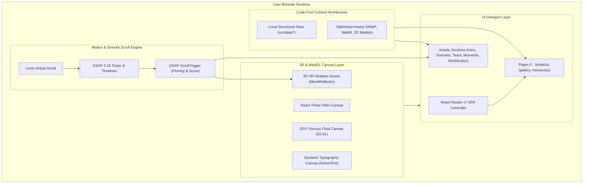
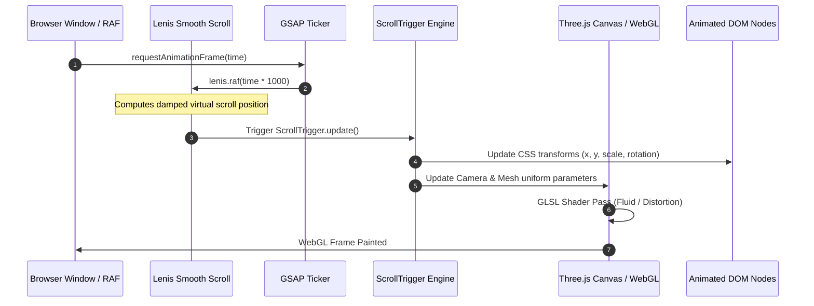

# 🏗️ System Architecture & Engineering Specifications

## RealXR Portfolio & Spatial Showcase Platform

This document describes the software architecture, render pipelines, component hierarchy, data contracts, and performance strategies powering **RealXR** as a self-contained, high-performance web application.

---

## 1. System Topology Overview

RealXR is built as a **standalone, code-driven, static-first web platform**. All visual scenes, 3D assets, shader pipelines, and content datasets reside directly within the `RealX-Website` repository.



---

## 2. Frontend Architecture & Technology Stack

### 2.1 Tech Stack Matrix
- **Runtime & Framework:** React 19 (`react`, `react-dom`), Vite 8, Tailwind CSS v4 (`@tailwindcss/vite`).
- **Routing:** React Router v7 (`createBrowserRouter`, `RouterProvider`).
- **3D & Canvas Graphics:** Three.js (`three`), React Three Fiber (`@react-three/fiber`), Drei (`@react-three/drei`).
- **Animation & Motion:** GSAP 3.15, `@gsap/react`, GSAP `ScrollTrigger`, Lenis 1.3, Framer Motion 12.
- **UI & Media Presentation:** Yet Another React Lightbox, Lucide React, FontAwesome SVG icons.
- **Build & Optimization:** Rolldown-powered Vite bundling with functional manual code-splitting.

### 2.2 Component Hierarchy & Routing Tree

```
App.jsx (createBrowserRouter)
└── RootLayout.jsx
    ├── Preloader.jsx (Asset readiness check + Reticle HUD animation)
    ├── CustomCursor.jsx (Physics trailing cursor + Magnetic snapping)
    ├── FluidCanvas.jsx (Background GPU-accelerated viscous fluid simulation)
    ├── Navbar.jsx (Dynamic navigation header, links, responsive drawer)
    ├── <Outlet /> (Dynamic view rendering)
    │   ├── Home.jsx (/)
    │   │   ├── Hero.jsx (3D Headset Scene + Marquee)
    │   │   ├── HeroVideo.jsx (Scroll-scrubbed video timeline)
    │   │   ├── About.jsx (Highlighted text blocks)
    │   │   ├── Domains.jsx (Pinned horizontal slider + dual marquees)
    │   │   ├── Projects.jsx (QuickTo cursor thumbnail + project rows)
    │   │   ├── EventsShowcase.jsx (Pinned moments matrix)
    │   │   ├── TeamIntro.jsx & Team.jsx (Roster squads)
    │   │   ├── Join.jsx (Application form funnel)
    │   │   └── RedSection.jsx (Institutional typography pinning)
    │   ├── GalleryDashboard.jsx (/gallery - Lazy loaded)
    │   │   ├── MediaGrid.jsx (Masonry layout)
    │   │   ├── MediaCard.jsx (Video/image preview tiles)
    │   │   └── Lightbox.jsx (Full-screen lightbox viewer)
    │   ├── Projects.jsx (/projects - Lazy loaded)
    │   │   ├── FeaturedSpotlight.jsx (Flagship project hero)
    │   │   ├── FilterTabs.jsx & SearchBar.jsx
    │   │   └── ProjectCard.jsx (Status badges, tags, links)
    │   └── Resource.jsx (/resources - Lazy loaded)
    │       ├── SearchBar.jsx & CategoryTabs
    │       └── ResourceCard.jsx (Difficulty pills, download links)
    └── Footer.jsx (Dual club/college branding, coordinates, inquiry links)
```

---

## 3. High-Performance Motion & WebGL Pipeline

To achieve an **Awwwards-level 60 FPS** interactive experience without frame drops or visual jitter, RealXR orchestrates Lenis, GSAP, and React Three Fiber into a unified tick lifecycle:



### 3.1 The Lenis + GSAP Synchronization Engine
Located in [`RootLayout.jsx`](file:///d:/CODING/Collage/RealXR-Portfolio/RealX-Website/src/components/layout/RootLayout.jsx):
1. **Gated Execution:** Lenis and ScrollTrigger only initialize after `Preloader` resolves (`isLoading === false`).
2. **Unified Ticker:** Lenis does not run its own isolated RAF loop. Instead, `gsap.ticker.add((time) => lenis.raf(time * 1000))` binds scroll calculation directly to GSAP's precision tick engine.
3. **Lag Smoothing Deactivation:** `gsap.ticker.lagSmoothing(0)` prevents animation stutter during heavy GPU compute spikes.
4. **Clean Teardown:** On unmount or route change, `lenis.destroy()`, `gsap.globalTimeline.clear()`, and `ScrollTrigger.getAll().forEach(st => st.kill())` execute cleanly to eliminate memory leaks.

### 3.2 Scroll-Scrubbed Video Pipeline
Located in [`HeroVideo.jsx`](file:///d:/CODING/Collage/RealXR-Portfolio/RealX-Website/src/sections/Hero/HeroVideo.jsx):
- **Decoder Pre-warming (`warmDecoder`):** Quickly plays and pauses the muted video stream upon mount to wake the GPU hardware video decoder, eliminating the 200–400ms seek latency on the initial scroll gesture.
- **MatchMedia Breakpoint Segregation:** Desktop screens execute accurate timeline scrubbing across scroll progress (`0.0 -> 1.0`), while mobile screens receive an optimized, battery-efficient layout.

### 3.3 Interactive 3D VR Headset Scene
Located in [`HeroScene.jsx`](file:///d:/CODING/Collage/RealXR-Portfolio/RealX-Website/src/sections/Hero/HeroScene.jsx):
- Handled inside an R3F `<Canvas>` using Drei's `MeshReflectorMaterial`.
- Employs pointer-event capture (`setPointerCapture`) to calculate delta velocities during user drag.
- On mouse release (`onPointerUp`), GSAP interpolates the mesh rotation back to equilibrium:
  ```javascript
  gsap.to(groupRef.current.rotation, {
    x: 0,
    y: 0,
    z: 0,
    duration: 1.2,
    ease: "power3.out"
  });
  ```

---

## 4. Code-First Content Architecture

The platform adopts a **code-first content model** managed entirely in JavaScript/JSON data modules located in [`src/data/`](file:///d:/CODING/Collage/RealXR-Portfolio/RealX-Website/src/data/):

| Content Domain | Data File | Structure & Features |
| :--- | :--- | :--- |
| **Hero & Tagline** | [`heroData.js`](file:///d:/CODING/Collage/RealXR-Portfolio/RealX-Website/src/data/heroData.js) | Title, tagline, circular college seal, 3D headset assets, video links, marquee ticker text. |
| **About & Mission** | [`aboutData.js`](file:///d:/CODING/Collage/RealXR-Portfolio/RealX-Website/src/data/aboutData.js) | Lab manifesto, technical pillars, and historical milestones. |
| **Domains Matrix** | [`domainsData.js`](file:///d:/CODING/Collage/RealXR-Portfolio/RealX-Website/src/data/domainsData.js) | AR, VR, Game Dev, 3D Modelling, WebXR disciplines, descriptions, and icon mappings. |
| **Featured Projects** | [`projectData.js`](file:///d:/CODING/Collage/RealXR-Portfolio/RealX-Website/src/data/projectData.js) | Homepage pinned project rows with mouse hover preview thumbnails. |
| **Projects Catalog** | [`projectsPageData.js`](file:///d:/CODING/Collage/RealXR-Portfolio/RealX-Website/src/data/projectsPageData.js) | Filterable catalog with status pills (`live`, `prototype`, `rnd`, `archived`), tech tags, and links. |
| **Events & Moments** | [`eventsData.js`](file:///d:/CODING/Collage/RealXR-Portfolio/RealX-Website/src/data/eventsData.js) | Hackathons, workshops, induction events, and moments photo assets. |
| **Gallery Albums** | [`galleryData.js`](file:///d:/CODING/Collage/RealXR-Portfolio/RealX-Website/src/data/galleryData.js) | Media albums with intrinsic aspect ratios, video clips, and captions for the Lightbox. |
| **Team & Alumni** | [`teamsData.js`](file:///d:/CODING/Collage/RealXR-Portfolio/RealX-Website/src/data/teamsData.js) | Functional squads (Leadership, Web Dev, AR/VR, Social, Alumni), member bios, and social links. |
| **Resource Vault** | [`resourceData.js`](file:///d:/CODING/Collage/RealXR-Portfolio/RealX-Website/src/data/resourceData.js) | Filterable spatial computing roadmaps, tools, papers, and tutorials with difficulty indicators. |

### Advantages of the Code-First Architecture:
- **Zero Downtime & 0ms Latency:** Content is bundled directly with the application. There are no external database round-trips, cold starts, or network timeouts.
- **Git-Tracked Revisions:** Every content change is tracked through Git history, with peer review and pull request workflows.
- **Type Safety & Integrity:** Content schemas are checked at build time (`npm run build`), preventing missing fields or broken image links from reaching production.
- **Static Edge Delivery:** Entire site and assets can be distributed globally across high-speed CDNs (Vercel, Cloudflare, Netlify) with minimal hosting costs.

---

## 5. Security & Performance Best Practices

1. **Client-Side Data Sanitization:** External URLs (GitHub, LinkedIn, social handles) are sanitized to secure HTTPS protocols and opened with `rel="noopener noreferrer"`.
2. **Lazy-Loaded Route Chunking:** Deep pages (`/projects`, `/gallery`, `/resources`) are dynamically imported via `React.lazy()` to keep initial JavaScript payloads under **150 kB**.
3. **Hardware Acceleration Controls:** WebGL canvases utilize `IntersectionObserver` gating to halt GPU rendering whenever off-screen, conserving battery life on mobile devices.
4. **Optimized Media Delivery:** All image assets are encoded in modern WebP with explicit dimension bounding to eliminate Cumulative Layout Shift (CLS).
