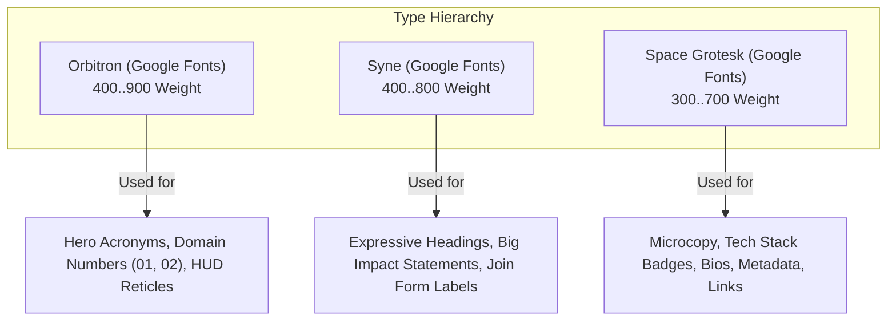
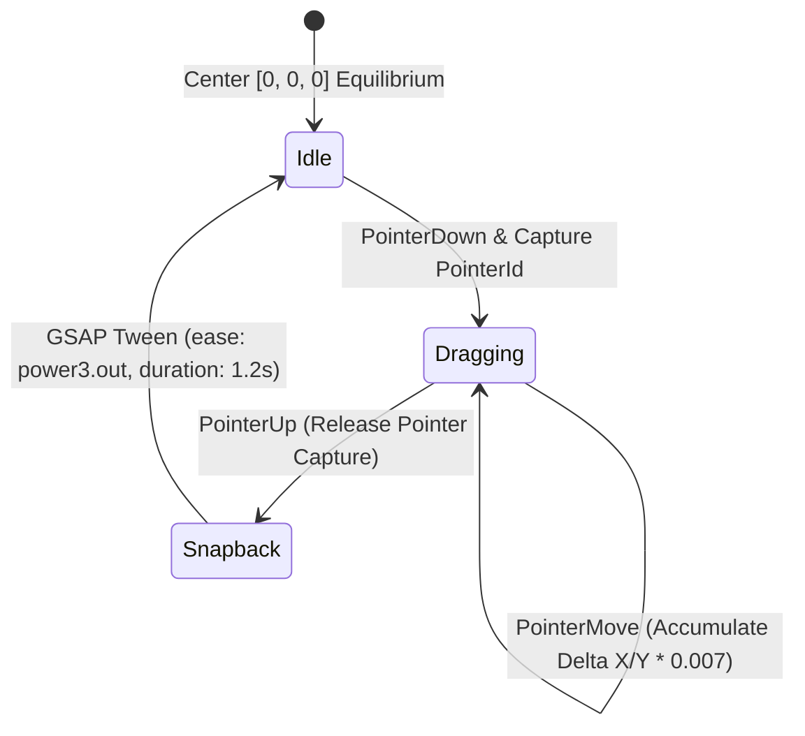

# 🎨 Design & 3D / Animation System Specification

## RealXR Portfolio & Spatial Showcase Platform

This document outlines the visual language, design tokens, typography, WebGL shader architecture, and GSAP motion choreography that define the **Awwwards-level** experience of RealXR.

---

## 1. Design Philosophy: Spatial Cyberpunk & Kinetic Precision

The aesthetic identity of RealXR bridges **spatial computing hardware aesthetics** (VR headsets, pass-through lenses, holographic HUDs) with **ultra-refined web typography and motion**.

```
        ┌─────────────────────────────────────────────────────────────┐
        │                 REALXR DESIGN PILLARS                       │
        ├─────────────────────────────────────────────────────────────┤
        │ 1. Deep Spatial Voids      (Pitch black #06070A canvas)     │
        │ 2. Luminous Neon Accents   (High-chroma spatial signals)    │
        │ 3. Kinetic Responsiveness  (Pointer physics & inertia)      │
        │ 4. Optical Depth & Shaders (GPU fluid dynamics & reflections│
        │ 5. Editorial Typography    (Orbitron, Syne, Space Grotesk)  │
        └─────────────────────────────────────────────────────────────┘
```

---

## 2. Design Tokens & Color Palette

### 2.1 Color Tokens
The interface utilizes pure dark voids contrasted against electric, high-chroma neon accents:

| Token Name | Hex Code | Visual Swatch | Usage Role |
| :--- | :--- | :--- | :--- |
| **Spatial Black** | `#06070A` | `■` | Primary app canvas background |
| **Obsidian Dark** | `#0D0F14` | `■` | Card containers & surface elevations |
| **Glass Border** | `rgba(255,255,255,0.08)` | `░` | Sub-pixel structural outlines |
| **Amber Signal** | `#FFB13C` | `■` | Primary brand accent & preloader ring |
| **Electric Cyan** | `#00F5D4` | `■` | Core Team accent & interactive highlights |
| **Cyber Crimson** | `#EF4444` | `■` | AR Domain accent & RedSection typography |
| **Hyper Indigo** | `#818CF8` | `■` | VR Domain accent & deep shadows |
| **Quantum Violet**| `#A78BFA` | `■` | Hackathon accents & past event tags |
| **Emerald Emerald**| `#10B981`| `■` | Live project status indicators |

---

## 3. Typography Architecture

RealXR pairs three distinct typefaces to convey futuristic technical sophistication:



### 3.1 Utility Classes in `src/index.css`
- `.orbitron-400` to `.orbitron-900`: Geometric tech aesthetic.
- `.syne-400` to `.syne-800`: Artistic editorial sans-serif.
- `.space-300` to `.space-700`: Monospace/grotesque balance for readability.

---

## 4. WebGL Shaders & 3D Interactive Canvas

### 4.1 GPU-Accelerated Viscous Fluid Canvas
Located in [`ViscousFluidMaterial.jsx`](file:///d:/CODING/Collage/RealXR-Portfolio/RealX-Website/src/components/three/ViscousFluidMaterial.jsx) & [`FluidCanvas.jsx`](file:///d:/CODING/Collage/RealXR-Portfolio/RealX-Website/src/components/three/FluidCanvas.jsx):

The fluid simulation is an interactive, hardware-accelerated WebGL shader rendered across the full screen background.

#### Shader Mechanics:
1. **Domain Warping:** Applies multi-octave 2D simplex noise warped recursively to simulate viscous liquid drag.
2. **Dynamic Pointer Tracking:** Receives mouse coordinates normalized to `[-1.0, 1.0]`, computing velocity and injecting directional force into the wave grid.
3. **Specular Lighting:** Evaluates surface normal gradients to calculate satin-like glossy reflections across liquid peaks.

#### Uniform Variables:
```glsl
uniform float uTime;             // Continuous animation ticker
uniform vec2  uPointer;          // Smooth damped mouse position
uniform vec2  uVelocity;         // Pointer motion delta
uniform vec3  uColor1;           // Primary base fluid tone (#040914)
uniform vec3  uColor2;           // Secondary fluid shade (#0a182d)
uniform vec3  uFluidColor;       // Interactive ripple flare (#00f2fe)
uniform float uRadius;           // Ripple influence radius (0.35)
uniform float uViscosity;        // Drag tracking inertia (0.05)
uniform float uDistortion;       // Surface wave displacement factor (0.18)
uniform float uSpecular;         // Specular reflection intensity (0.4)
```

---

### 4.2 Interactive 3D VR Headset Scene
Located in [`HeroScene.jsx`](file:///d:/CODING/Collage/RealXR-Portfolio/RealX-Website/src/sections/Hero/HeroScene.jsx):



#### Key Implementation Details:
- **Pointer Capture:** Uses `e.target.setPointerCapture(e.pointerId)` so rotation continues fluidly even if the cursor moves outside the browser canvas boundary.
- **Physics Snap-Back:** On release, `gsap.killTweensOf(groupRef.current.rotation)` cancels any competing tween, and an easing curve (`power3.out`) smoothly guides the 3D model back to `[0, 0, 0]`.
- **Drei MeshReflectorMaterial:** Casts realistic ground reflections beneath the headset, grounding the 3D geometry in virtual space.

---

### 4.3 Typography Vertex Distortion Shader
Located in [`DistortText.jsx`](file:///d:/CODING/Collage/RealXR-Portfolio/RealX-Website/src/components/three/DistortText.jsx) & [`TextDistortMaterial.js`](file:///d:/CODING/Collage/RealXR-Portfolio/RealX-Website/src/components/three/TextDistortMaterial.js):
- Custom vertex shader that displaces 3D text glyph geometry using high-frequency sine waves:
  ```glsl
  vec3 transformed = position;
  transformed.z += sin(transformed.x * uFrequency + uTime * uSpeed) * uAmplitude;
  ```
- Creates an undulating holographic disturbance effect for major titles.

---

## 5. Motion Choreography & Scroll Experience

### 5.1 Lenis Smooth Scroll Configuration
Located in [`RootLayout.jsx`](file:///d:/CODING/Collage/RealXR-Portfolio/RealX-Website/src/components/layout/RootLayout.jsx):
- **Formula:** `(t) => Math.min(1, 1.001 - Math.pow(2, -10 * t))`
- **Smoothness Duration:** `1.2` seconds.
- **Virtual Wheel:** `smoothWheel: true` intercepts mouse-wheel increments to produce frictionless gliding without jerky step jumps.

### 5.2 Scroll-Scrubbed Hero Video
Located in [`HeroVideo.jsx`](file:///d:/CODING/Collage/RealXR-Portfolio/RealX-Website/src/sections/Hero/HeroVideo.jsx):
- **Decoder Pre-warming:** Immediately triggers a microscopic play/pause cycle (`warmDecoder`) while opacity is 0 so the browser hardware video pipeline is ready for immediate frame seeking.
- **Scroll Pinning:** Pinned for 300vh of scroll distance. Scroll progress `0.0` through `1.0` maps directly to `video.currentTime = progress * video.duration`.
- **MatchMedia Optimization:** Disabled on mobile viewports (`max-width: 768px`) to preserve GPU battery life and ensure compatibility on lower-spec mobile devices.

### 5.3 QuickTo Interactive Cursor Card (Projects Section)
Located in [`Projects.jsx`](file:///d:/CODING/Collage/RealXR-Portfolio/RealX-Website/src/sections/Projects/Projects.jsx):
- Uses `gsap.quickTo` for high-frequency `(x, y)` coordinate updates without creating garbage collector pressure.
- As the user hovers over project rows, the floating card expands from `scale: 0` to `scale: 1` and cross-fades the target project preview screenshot.
- Marquee text velocity automatically scales with page scroll speed:
  ```javascript
  ScrollTrigger.create({
    onUpdate: (self) => {
      const velocity = Math.abs(self.getVelocity() / 300);
      gsap.to(marqueeTween, { timeScale: 1 + velocity, duration: 0.2 });
    }
  });
  ```

### 5.4 Moments 3D Photo Particle Rain
Located in [`Moments.jsx`](file:///d:/CODING/Collage/RealXR-Portfolio/RealX-Website/src/sections/Events/Moments.jsx):
- Multiple event photos spawn across random horizontal coordinates (`startX = 2%..98%`).
- Randomized scale (`0.3..1.0`), duration (`8s..16s`), and rotational tilt (`-35deg..+35deg`).
- Deep 3D depth-layering: Larger photos receive higher z-index and opacity, creating realistic perspective parallax as images drift through space.

### 5.5 Pinned Kinetic Typography (`RedSection.jsx`)
Located in [`RedSection.jsx`](file:///d:/CODING/Collage/RealXR-Portfolio/RealX-Website/src/sections/Footer/RedSection.jsx):
- Pinned for `+=130%` of viewport height.
- Counter-directional typographic explosion:
  - `Line 1` translates `-25%` horizontally with fade out.
  - `Line 3` translates `+25%` horizontally with fade out.
  - `Line 2` scales up to `1.05` with subtle outline styling.
  - Deep watermark text scales up from `0.85` to `1.0` in the background.

---

## 6. Accessibility & Performance Guardrails

1. **Reduced Motion Detection:**
   ```css
   @media (prefers-reduced-motion: reduce) {
     [style*="animation"] { animation: none !important; }
   }
   ```
2. **Hidden Native Scrollbars:** The native browser scrollbar is suppressed via `.scrollbar-none` utilities while Lenis manages standard keyboard, scroll wheel, and touch navigation.
3. **Fine Pointer Conditioning:** Custom cursor rendering is exclusively enabled on devices supporting fine pointer accuracy (`@media (pointer: fine)`). On touch devices, native mobile gestures operate without interference.

